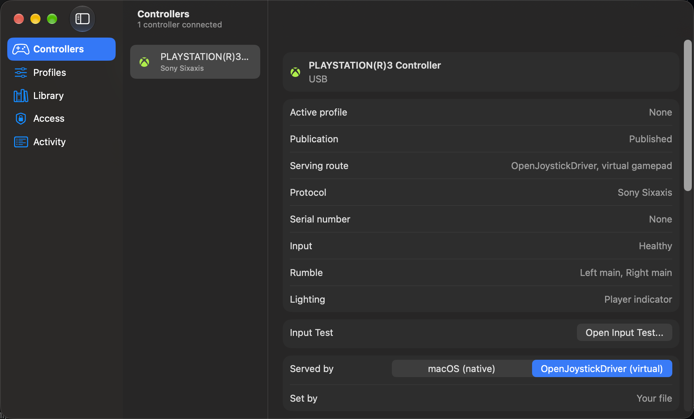
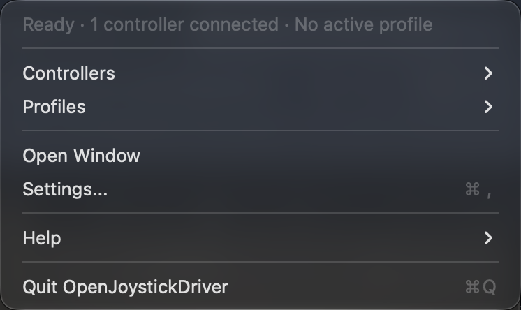
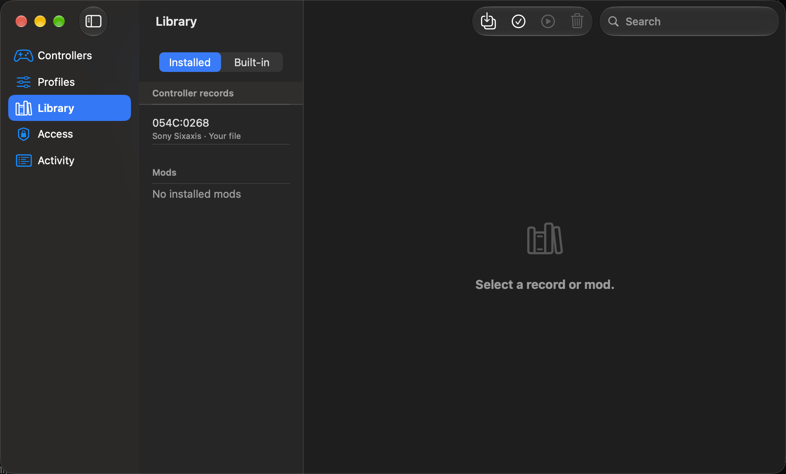
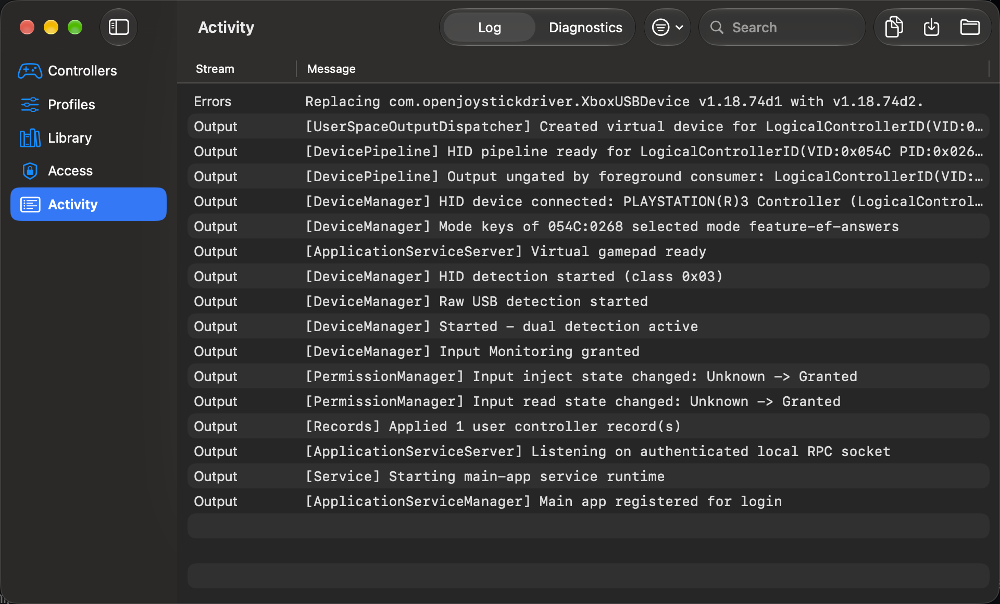
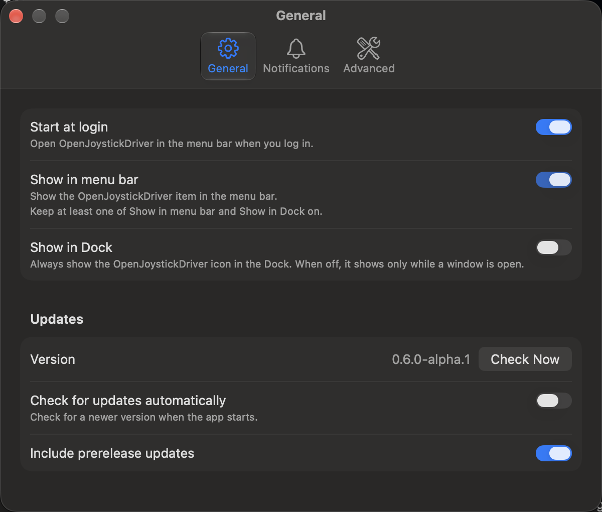

# OpenJoystickDriver

**Play Mac games with the controller you already own:**
OpenJoystickDriver (OJD) is a free, open-source menu-bar app that shows your controller to Mac games as a standard controller, including controllers that macOS does not support.

[![GitHub Repo stars][1]](https://github.com/xsyetopz/OpenJoystickDriver/stargazers) [![License][2]](LICENSE) [![macOS 12 or later][3]](#system-requirements) [![GitHub Sponsors][4]](https://github.com/sponsors/xsyetopz)

> [!WARNING]
> Version 0.6.0-alpha.1 is an alpha.
> Many controllers have no hardware test yet, and some games and apps do not read the virtual controller.
> See [Supported controllers](https://github.com/xsyetopz/OpenJoystickDriver/wiki/Supported-Controllers) and [Playing games](https://github.com/xsyetopz/OpenJoystickDriver/wiki/Playing-Games) for what is confirmed, and [report your result](https://github.com/xsyetopz/OpenJoystickDriver/wiki/Reporting-a-Bug) to help.

OJD reads a physical controller over USB, Bluetooth, or a 2.4 GHz dongle and publishes a virtual controller that games read.

## What It Does

- **Many controller families:**
  A built-in catalog of 696 controller records covers Xbox, PlayStation, Nintendo Switch, Steam, GameSir, NVIDIA SHIELD, and Flydigi controllers, plus generic HID gamepads.
  A record does not prove that a controller works: only the controllers that the [support table](https://github.com/xsyetopz/OpenJoystickDriver/wiki/Supported-Controllers) lists as Official or Community-verified have a hardware test.
- **A virtual controller for games:**
  Games read one virtual controller for each physical controller, as an Xbox Wireless Controller (`SDLCompatible`) or a generic gamepad (`Generic`).
  OJD selects the profile, and you can choose the other one.
- **SDL and Steam:**
  `ojd virtual launch` starts a program with the SDL mapping of your virtual controllers, and `ojd virtual export-mapping` prints SDL and W3C mappings.
  Steam is not verified to work.
- **Profiles and remapping:**
  Assign buttons, combinations, sequences, and layers, and send controller input as keyboard, pointer, or scroll events.
- **An input test:**
  See each button, stick, and trigger move before you start a game.
- **Mods:**
  Share controllers, patches, profiles, and virtual devices as a folder and install it with `ojd mod install`.
- **No kernel extension:**
  OJD does not need you to turn off SIP or AMFI.

## Screenshots

## Install

1. Download `OpenJoystickDriver-0.6.0-alpha.1-macOS.dmg` from the [releases](https://github.com/xsyetopz/OpenJoystickDriver/releases).
2. Open the disk image and drag **OpenJoystickDriver.app** onto the **Applications** shortcut.
3. Open **OpenJoystickDriver** from the Applications folder.
   Keep it in `/Applications`.
4. On macOS 13 and later, if macOS asks, allow the login item in **System Settings** > **General** > **Login Items**.
5. For an Xbox One or Xbox Series controller on USB, approve the driver extension in **System Settings** > **General** > **Login Items & Extensions** > **Driver Extensions**.

To build the app yourself, see [Building from source](https://github.com/xsyetopz/OpenJoystickDriver/wiki/Building-from-Source).

## System Requirements

- macOS 12 (Monterey) or later.
- A Mac with Apple silicon or an Intel processor.
  The app contains both.
- A controller.

## Quick Start

1. Click the controller icon in the menu bar.
   If the menu shows **Grant Access**, click it and allow OpenJoystickDriver in **Input Monitoring** and **Accessibility**.
   If the **Access** area shows **Restart OpenJoystickDriver**, click it.
2. Connect your controller.
3. In the **Controllers** area, select the controller and click **Open Input Test...** to see each control.
4. Play a game.
   The game reads the virtual controller.

If something does not work, see [Troubleshooting](https://github.com/xsyetopz/OpenJoystickDriver/wiki/Troubleshooting).

## Star This Project

If OJD makes your controller work, star the repository.
Stars help other Mac players find it.

[Star OpenJoystickDriver on GitHub](https://github.com/xsyetopz/OpenJoystickDriver)

## Sponsorship

[Sponsor the project on GitHub Sponsors](https://github.com/sponsors/xsyetopz).
The money pays for the tools used to build the apps and for the controllers tested directly on the maintainer's Macs: Apple silicon on macOS 27 and Intel on macOS 12.

## Documentation and Contributing

- User documentation: the [wiki](https://github.com/xsyetopz/OpenJoystickDriver/wiki), starting with [Getting started](https://github.com/xsyetopz/OpenJoystickDriver/wiki/Getting-Started), [Using the app](https://github.com/xsyetopz/OpenJoystickDriver/wiki/Using-the-App), and [Remapping profiles](https://github.com/xsyetopz/OpenJoystickDriver/wiki/Remapping-Profiles).
- Command line: [Command line](https://github.com/xsyetopz/OpenJoystickDriver/wiki/Command-Line) and [Command reference](https://github.com/xsyetopz/OpenJoystickDriver/wiki/Command-Reference).
- Tested a controller: [Reporting a bug](https://github.com/xsyetopz/OpenJoystickDriver/wiki/Reporting-a-Bug) explains how to send the result.
- Contribute: [CONTRIBUTING.md](CONTRIBUTING.md), [docs/README.md](docs/README.md), [LOCALIZATION.md](LOCALIZATION.md), [Tools/README.md](Tools/README.md), and [AGENTS.md](AGENTS.md).
- Security: [SECURITY.md](SECURITY.md).

Xbox and PlayStation names in the UI are trademarks of Microsoft and Sony.
This project is not affiliated with either.
[Microsoft](https://www.microsoft.com/en-us/legal/intellectualproperty/trademarks) · [PlayStation](https://www.playstation.com/en-us/legal/copyright-and-trademark-notice/).

## License

[MIT](LICENSE)

## Star History

[![Star History Chart][5]][6]

[1]: https://img.shields.io/github/stars/xsyetopz/OpenJoystickDriver?style=social
[2]: https://img.shields.io/github/license/xsyetopz/OpenJoystickDriver
[3]: https://img.shields.io/badge/macOS-12%2B-000000?logo=apple
[4]: https://img.shields.io/badge/sponsor-30363D?logo=githubsponsors&logoColor=EA4AAA
[5]: https://api.star-history.com/chart?repos=xsyetopz/OpenJoystickDriver&type=date&legend=top-left&sealed_token=PjXIM3WljCuileJs_cIh3xVcAUk_S-XIvzSI-4YZXyrdXUDv_5yKL-bki0BDGSsz92-vhQ9_yqKPxyBC0RsY1Cd0C-e0YWUXePQkgLZcoXOiDCgazJpBqvW2rzdCZb8gK-1y7jncPZsFa8yqvijYWxA1UuP7Kw2Knvq2XnUuoMlTbtNobOEAx47QZF0U
[6]: https://www.star-history.com/?repos=xsyetopz%2FOpenJoystickDriver&type=date&legend=top-left
