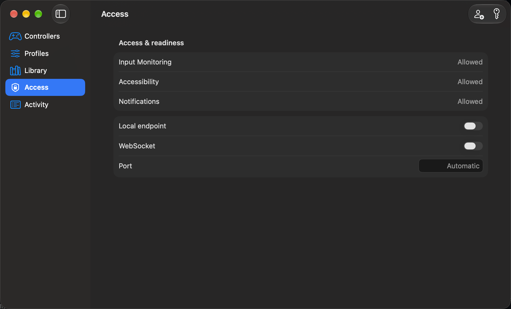
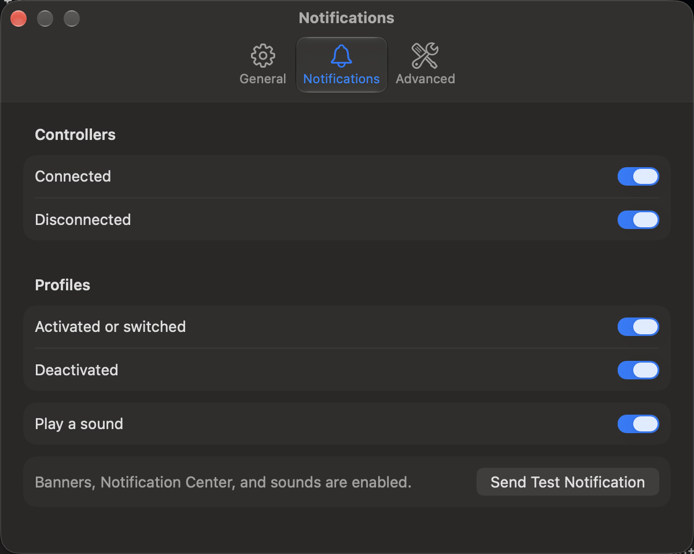
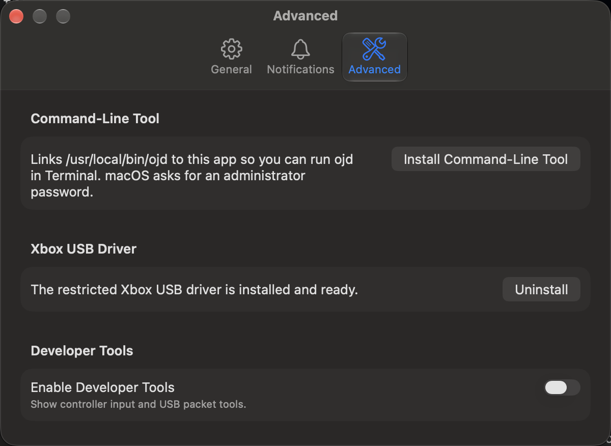

# Using the App

Learn the menu-bar item, the main menu, the five areas of the app window, and the Settings window.

## Contents

- [Menu-bar item](#menu-bar-item)
- [Main window](#main-window)
- [Controllers area](#controllers-area)
- [Profiles area](#profiles-area)
- [Library area](#library-area)
- [Access area](#access-area)
- [Activity area](#activity-area)
- [Settings window](#settings-window)
- [Testing a controller](#testing-a-controller)
- [Further reading](#further-reading)

## Menu-Bar Item

The menu-bar item shows OpenJoystickDriver status and opens the app window.
**Show in menu bar** and **Show in Dock** in **Settings** > **General** choose where the app shows its icon.
At least one of them stays on.

### Menu Items

The menu contains these items, from top to bottom:

- A status row that you cannot click.
  It shows readiness, the number of controllers, and the active profile.
- **Controllers** lists each connected controller as a submenu.
  **No Controller Connected** appears when the list is empty.
- **Profiles** has **Activate** and **Deactivate** submenus.
  **Activate** lists every profile and checks the active one.
  **Deactivate** lists the active profiles.
  A submenu with nothing to list still opens and shows one dimmed row: **No Profiles** in **Activate**, **No Active Profile** in **Deactivate**, or **Profiles Unavailable** in either while the profile list is loading or cannot be read.
- **Grant Access** appears only when a permission is missing.
  It opens the **Access** area.
- **Open Window** opens the app window on the area you used last.
- **Settings...** opens the **Settings** window.
- **Help** contains **Activity Log**, **Explain Error Code...**, **Report Problem...**, and **Project Website**.
- **Quit OpenJoystickDriver** stops OJD.

### Controller Entries

Each controller in the **Controllers** submenu has its own submenu:

- **Suspend** pauses input, physical effects, and virtual output for this controller.
  While the controller is suspended, the item reads **Resume**.
- **Test Input** opens the Input Test window.
- **Active Profile** lists the profiles that apply to this controller and checks the active one.
  With none, it shows a dimmed **No Profiles** row, or **Profiles Unavailable** while the profile list is loading or cannot be read.
- **Disconnect Wireless Link** is on only for a controller that connects by Bluetooth.
  OJD shows a **Disconnect Wireless Controller?** alert to confirm.
  The controller stays disconnected until you connect it again by hand.
  OJD cannot disconnect a Bluetooth Low Energy controller: turn it off or disconnect it in **System Settings** > **Bluetooth**.
- **Show in Window** opens the controller in the **Controllers** area.

### Quit and Reopen

Quit stops the runtime.
OJD does not start again by itself unless **Start at login** is on.
Start it from the Applications folder.
Closing the window with the red button only hides it.

## Main Window

The app window has a sidebar with five areas.
Press <kbd>Command</kbd>+<kbd>1</kbd> to <kbd>Command</kbd>+<kbd>5</kbd> to select them in this order:

| Area | Use it to |
| --- | --- |
| **Controllers** | See each connected controller, choose who serves it, and test it. |
| **Profiles** | Edit remapping profiles. |
| **Library** | Install, test, and remove controller records and mods. |
| **Access** | Check permissions, and manage the local endpoint for other programs. |
| **Activity** | Read the log, run checks, and explain an error code. |

The window opens on **Controllers** until you choose another area.
**View** > **Hide Sidebar** hides the sidebar.

A banner below the toolbar shows a problem that stops OJD from working:

- **OpenJoystickDriver cannot reach its service**.
- **Xbox USB Driver**, when the driver extension needs approval, repair, or reinstalling.
- **Permission needed**, with a button that opens **Access**.
- **Live updates unavailable**, when the app cannot receive changes from the service.
  The app then reads the controller list from the service instead, and tries to receive changes again.
  The banner disappears when live updates work again.

### Main Menu

The main menu follows the macOS layout:

- **File** has **Import Profile...**, **Install Record or Mod...**, **Close**, **Export Profile...**, **Save Support Report...**, and **Save Activity Log...**.
- **View** selects the five areas and shows or hides the sidebar and the toolbar.
- **Controller** has **Suspend**, **Resume**, **Test Input**, **Disconnect Wireless Link**, and **Show in Window** for the selected controller.
- **Profile** has **Activate Profile** and **Deactivate Profile**.
  While no profile exists, the **Activate Profile** submenu shows **No Profiles**; while the profile list is loading or cannot be read, it shows **Profiles Unavailable**.
- **Help** has **Activity Log**, **Explain Error Code...**, **Copy Support Report**, **Report Problem...**, and **Project Website**.
  For more information, see [Reporting a bug](Reporting-a-Bug.md).

## Controllers Area

The **Controllers** area lists connected controllers and shows details for the selected controller.
The list updates by itself when a controller connects or disconnects.
If no controller appears, the area shows **No controller connected**.
For more information, see [Controller not detected](Troubleshooting.md).

### Controller Details

The details include these fields when the controller reports them:

- **Active profile**.
- **Publication**: whether OJD publishes a virtual gamepad for the controller.
  A controller that macOS serves itself shows **Native macOS gamepad, not published**.
- **Serving route**: how the input reaches games, for example **OpenJoystickDriver, virtual gamepad** or **macOS, passed through**.
- **Protocol**.
- **Serial number**, blurred until you click its eye button.
- **Battery**, **Charging state**, and **Cable state**.

A **Suspended** row with a **Resume** button appears while the controller is suspended.
**Open Input Test...** opens the test window.
For more information, see [Testing a controller](Testing-a-Controller.md).

### Who Serves the Controller

The **Served by** picker appears for a controller that macOS serves natively, or whose record gives it to OpenJoystickDriver.
It never appears for a controller that uses raw USB or the driver extension.
The choices are **macOS (native)** and **OpenJoystickDriver (virtual)**.
**Set by** names the record layer that holds the choice.
The change takes effect at once and stays after a restart.
The command line does the same with `ojd controller claim` and `ojd controller release`.
For more information, see [Choose who drives the controller](Controller-Records.md#choose-who-drives-the-controller).

### Virtual HID Profile

The **Virtual HID profile** menu appears for controllers that macOS does not serve itself:

- **Automatic (<profile name>)** lets OJD choose the virtual controller profile and names the profile it chose.
- **Xbox Adaptive Controller (SDLCompatible)** forces the Xbox profile for SDL games and Steam.
- **OpenJoystickDriver Generic HID Gamepad (Generic)** forces the generic profile.
- **Xbox Wireless Controller (GameControllerCompatible)** forces the Xbox profile for Apple's Game Controller framework.

**Apply to** chooses whether the override applies to every connected controller of the same model or to this controller only.
**Reset all overrides** clears every override.

The change takes effect at once.
**Updating virtual HID profile...** shows while it applies.
If activation fails, OJD restores the previous profile and shows a message.
For more information, see [How games see your controller](Playing-Games.md).

### Virtual Gamepad Actions

The detail also has **Export mapping**, which saves the SDL mapping or the W3C Gamepad description of the virtual gamepad, and **Launch game with virtual gamepad**, which starts a program with the mapping set.

### Advanced Section

The **Advanced** section holds the identifiers, the input and output endpoints, **Draft Record...**, and **Capture Packets...**.
**USB VID/PID** is the vendor and product ID.
For more information, see [Finding your controller ID](Connecting-Controllers.md).

## Profiles Area

The **Profiles** area lists the remapping profiles and opens the editor for the selected profile.
For more information, see [Remapping profiles](Remapping-Profiles.md).

## Library Area

The **Library** area lists the **Controller records** and the **Mods** that are installed.
Select an item to see its fields and files.

- **Install** adds a controller record file or a mod folder.
  **Validate...** checks it first.
  **Replace** overwrites an installed item with the same name.
  **Remove** deletes it after you confirm.
- **Test Record...** replays a packet capture through a record and compares the result with the state you expect.
- **Search** filters the list.

For more information, see [Writing controller mods](Writing-Controller-Mods.md) and [Controller records](Controller-Records.md).

## Access Area

The **Access** area shows what OJD is allowed to do, and which programs may read your controllers.

### Permissions

Rows show **Input Monitoring**, **Accessibility**, and **Notifications**.
A **Keyboard & pointer** row appears between **Accessibility** and **Notifications** while an active profile posts keyboard, pointer, or scroll events.
Each row shows one value:

- **Allowed**
- **Needs attention**
- **Checking...**
- **Not requested**, **Banners off**, or **Sound off** (only for **Notifications**)

A row that needs attention has a **Request...** button, or **Open System Settings** when macOS already knows the request.
If **Input Monitoring** or **Accessibility** is not allowed, **Restart OpenJoystickDriver** appears.
For more information, see [Permissions](Permissions-and-Security.md#permissions).

### Local Endpoint

The local endpoint lets other programs read controller state.
It shows the socket path with **Copy Socket Path**, and the **WebSocket** with its **Port** and pages folder.
Turning on **Local endpoint** or **WebSocket** asks you to confirm with **Turn On**.

- **Programs with access** lists each granted program with its scopes, **Read** and **Control**, and **Revoke**.
  **Grant a Program...** adds one.
  OJD refuses a program that is not signed.
- **Tokens** lists the tokens.
  **Create a Token...** asks for a name, the scopes, and the web origins that may use the token.
  OJD shows the token once; copy it then.
- **Refused recently** lists the programs and tokens that the endpoint turned away in the last 24 hours.
- **Connected now** lists the open connections.

For more information, see [Automating OpenJoystickDriver](Automating-OpenJoystickDriver.md).

## Activity Area

The **Activity** area has two modes.

- **Log** shows the OpenJoystickDriver log.
  **Stream** selects **All**, **Output**, or **Errors**.
  **Lines** sets how many lines show, **Search** and **Filter** narrow them, and **Show in Finder** opens the log folder.
  If there are no lines, the area shows **No log entries.**
- **Diagnostics** shows the result of **Run Checks**: one row per check with **Passed**, **Warning**, or **Skipped**, and its details.

**Explain Error Code...** in the **Help** menu shows what an error code means.
For more information, see [Reporting a bug](Reporting-a-Bug.md).

## Settings Window

Open **Settings** from the app menu or press <kbd>Command</kbd>+<kbd>,</kbd>.
The window has three panes.

### General

**Start at login** opens OJD in the menu bar when you log in.
It needs macOS 13 or later.
If macOS needs approval, allow OJD in **System Settings** > **General** > **Login Items**.

The switch shows what macOS reports, so a change made in **System Settings** appears here.
Turning the switch off here, or running `ojd setting set launchAtLogin false`, also records that you opted out, so OJD does not register itself again at the next start.
A change made only in **System Settings** records nothing.
For more information, see [Command reference](Command-Reference.md).

**Show in menu bar** and **Show in Dock** choose where the icon shows.
When **Show in Dock** is off, the Dock icon shows only while a window is open.

Under **Updates**, **Check for updates automatically** looks for a newer version when the app starts.
Click **Check Now** to look at once.
OJD contacts GitHub only for these checks.
The result is **Up to date**, **Update available**, or **Newer than the latest release**.
Click **View Update** to open the release page.
OJD does not download or install anything.
Select **Include prerelease updates** to include beta versions.

### Notifications

Turn notifications on for these events:

- **Controllers**: **Connected** and **Disconnected**.
- **Profiles**: **Activated or switched** and **Deactivated**.
- **Play a sound**.

Click **Send Test Notification** to test delivery.
The app asks the service, which announces the test notification back to the app, and shows the result in the window: a denied permission, a failed delivery or no answer. `ojd setting test-notification` does the same from a terminal.
If macOS denies notifications, OJD turns the toggles off.
Click **Open Notification Settings** to fix this.

### Advanced

- **Command-Line Tool** links `ojd` to this app so that you can run it in Terminal.
  **Install Command-Line Tool** asks for an administrator password.
- **Xbox USB Driver** shows the state of the OJD driver extension.
  Only some Xbox One and Xbox Series controllers on USB need it.
  **Uninstall** appears while the driver is active; it asks you to approve and then deactivates the driver.
  For more information, see [Xbox USB driver extension](Connecting-Controllers.md#xbox-usb-driver-extension).
- **Enable Developer Tools** shows controller input and USB packet tools in this pane.
  For more information, see [Finding your controller ID](Connecting-Controllers.md).

If the settings file cannot be read, the app shows **Settings can't be read** with **Reset Settings**. `ojd setting reset` does the same from a terminal.

## Testing a Controller

The Input Test window shows live input, rumble, and lighting.
For more information, see [Testing a controller](Testing-a-Controller.md).

## Further Reading

- [Testing a controller](Testing-a-Controller.md)
- [Permissions](Permissions-and-Security.md#permissions)
- [Controller not detected](Troubleshooting.md)
- [Connection types](Connecting-Controllers.md)
- [Known issues](Known-Issues.md)
- [Updating OpenJoystickDriver](Updating-and-Uninstalling.md)
